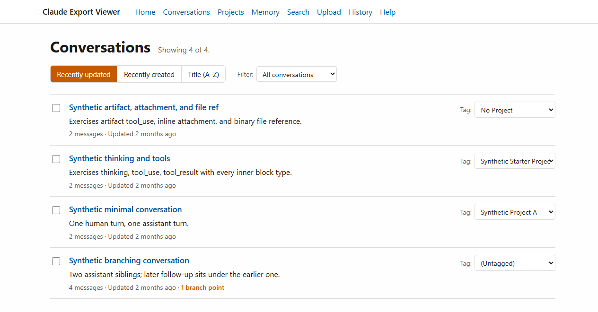
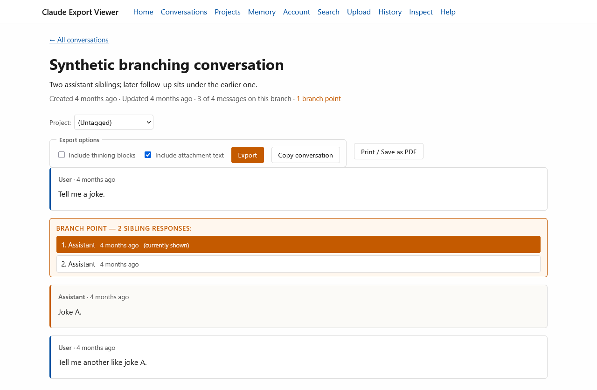
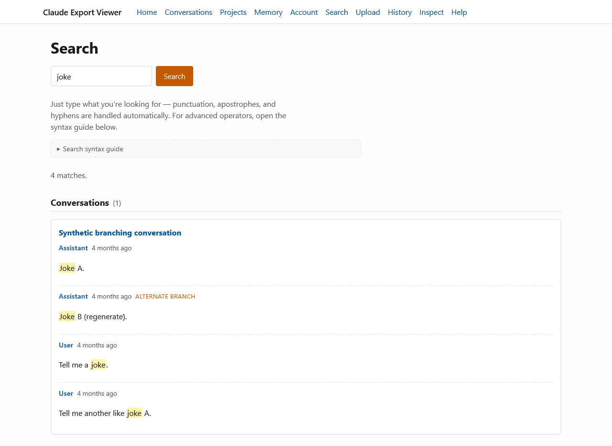
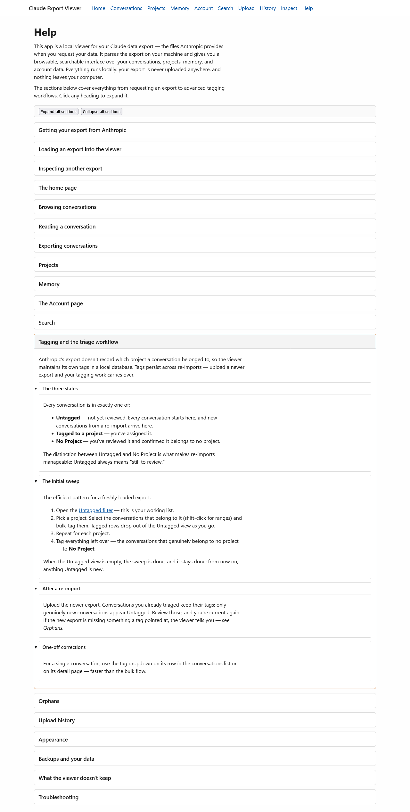

# Claude Export Viewer

A local web app for reading your Claude.ai data export — the ZIP archive Anthropic sends when
you request your data. It gives you a browsable, searchable interface over your conversations
(including the full branch history of regenerated and edited messages), your projects, and
Claude's memory, with project tagging, full-text search, and upload history. Everything runs on
your own machine: the export is parsed locally, and nothing is uploaded anywhere.

## Screenshots

Screenshots show the app's built-in sample data.

The conversations list, with sorting, tag filtering, and per-conversation tags:



Reading a conversation at a branch point — the switcher shows sibling responses and marks the
one currently displayed:



Search results with highlighted hits, including matches on alternate branches:



The in-app help page, with one section expanded:



## Features

- **Conversation browsing with branch navigation.** Regenerated and edited messages appear as
  branch points with a switcher; every branch is reachable, and a given branch combination has
  a stable URL you can bookmark.
- **Project pages** with each project's description, custom instructions, and knowledge
  documents rendered in full.
- **Tagging and triage.** The export doesn't record which project a conversation belonged to,
  so the viewer keeps its own tags in a local database. Every conversation is either Untagged
  (not yet reviewed), tagged to a project, or confirmed as No Project — and tags persist when
  you upload a newer export, so the triage work stays done. Bulk tagging with shift-click
  range selection is built in.
- **Memory rendering.** Claude's global memory and per-project memories, with collapsible
  sections.
- **Full-text search** (SQLite FTS5) across messages — including alternate branches — titles,
  summaries, projects, knowledge documents, and memory. Natural-language queries work as-is; a
  built-in syntax guide covers phrases, prefixes, proximity, and boolean operators. Results
  link to the exact message, on the right branch.
- **Upload history.** Every export load is recorded — when, the filename, a content
  fingerprint, and the headline counts — so over time it doubles as a record of how your
  archive has grown.
- **Inspect mode** — open a second export read-only, without touching your own data, tags, or
  history; one click returns you to your own archive.
- **Conversation export** — download any conversation as Markdown (single files or a bulk ZIP
  of a selection), with a YAML metadata header and honest markers for anything omitted;
  thinking blocks are opt-in.
- **Print and PDF** — print or save any conversation as PDF from the browser, with a links
  appendix and what-you-see-is-what-you-get handling of collapsed sections.
- **Thinking blocks** — Claude's reasoning is preserved and rendered as collapsible sections
  within each conversation, flagged where the export marks a block truncated or cut off.
- **Syntax-highlighted code blocks**, via a vendored copy of highlight.js (no CDN).
- **In-app help** covering everything from requesting an export to the tagging workflow.

## Privacy and scope

This is a personal, local tool — that shapes everything about it:

- **Local-only.** No telemetry, no analytics, and no network calls at runtime. The only time
  anything touches the network is when dependencies are installed.
- **Your data stays put.** The loaded export and the tag/history database live in the
  project's `cache/` folder, on your machine, and nowhere else.
- **Not a hosted service.** The app runs Flask's development server bound to `127.0.0.1`. It
  has no authentication and is not designed to be exposed to a network — don't.

## Quick start

Requires Python 3.11 or newer — if you don't have it, install it from
[python.org/downloads](https://www.python.org/downloads/).

1. Download or clone this repository.
2. Start the app:
   - **Windows:** double-click `run.bat`.
   - **macOS / Linux:** run `./run.sh` (if that gives a permission error, `bash run.sh`).
3. The first run creates a local virtual environment and installs dependencies (later runs
   skip this), then starts the app and opens your browser. If port 5000 is busy, the launcher
   picks the next free port and prints the address.

Prefer to do it by hand?

```
python -m venv .venv
.venv\Scripts\activate          # Windows
source .venv/bin/activate       # macOS / Linux
pip install -e .
flask --app app run
```

Then open http://127.0.0.1:5000/.

## Getting your export

In Claude (claude.ai or the desktop app), click your initials in the lower-left corner, open
**Settings**, go to **Privacy**, and click **Export data**. Anthropic emails you a download link — it expires after 24 hours, so download
promptly. Upload the ZIP to the viewer exactly as downloaded; there's no need to unzip it. The
in-app **Help** page covers the rest, from what the export contains to backups and
troubleshooting.

## Development

```
pip install -e ".[dev]"
pytest                          # test suite
ruff check . && black .         # lint and format
```

Design notes live in [docs/](docs/): the export schema reference, the artifact-encoding study,
and the working plan.

## Licence

MIT — see [LICENSE](LICENSE).
